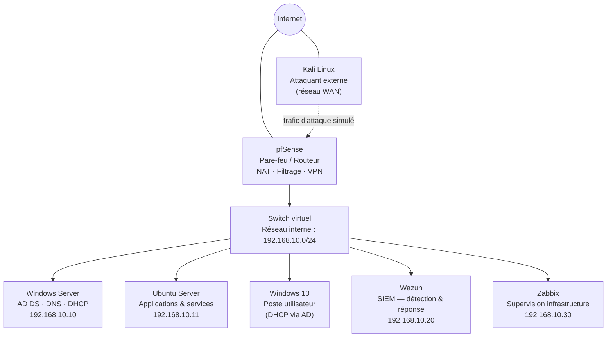

# 🛡️ Mon Laboratoire Réseau d'Entreprise

> Architecture complète, sécurisée et supervisée — conçue pour apprendre, tester et maîtriser les technologies réseau, sécurité et supervision dans un environnement réaliste et contrôlé.

Ce dépôt rassemble l'ensemble des projets réalisés dans mon laboratoire personnel : pare-feu périmétrique, Active Directory, sécurité applicative, détection d'intrusion (SIEM) et supervision d'infrastructure. Chaque brique a été montée, cassée, dépannée et documentée — cette page en donne la vue d'ensemble.

## Vue d'ensemble de l'architecture

> **Pourquoi Kali côté WAN plutôt que dans le LAN ?** Ce choix simule un attaquant externe réel (scénario le plus courant pour un poste SOC/périmétrique), plutôt qu'une menace interne. Le même Kali peut être repositionné dans le LAN pour des scénarios de red-team interne si besoin — l'architecture le permet sans rien reconstruire.

## Plan d'adressage IP

| Machine / Service | Adresse IP | Rôle |
|---|---|---|
| pfSense (LAN) | 192.168.10.1 | Passerelle, pare-feu, routage |
| Windows Server | 192.168.10.10 (statique) | Active Directory, DNS, **DHCP** |
| Ubuntu Server | 192.168.10.11 (statique) | Applications et services (web, BDD…) |
| Windows 10 | DHCP (bail AD) | Poste utilisateur, joint au domaine |
| Wazuh | 192.168.10.20 (statique) | SIEM — analyse des événements de sécurité |
| Zabbix | 192.168.10.30 (statique) | Supervision des ressources et de la disponibilité |
| Kali Linux | Réseau externe (WAN, pont) | Tests d'intrusion et simulations d'attaque |
| Réseau LAN | 192.168.10.0/24 | Segment interne de l'entreprise simulée |

> **Note de conception** — Le DHCP est assuré par **Windows Server / Active Directory** (plus représentatif d'un vrai SI d'entreprise) plutôt que par pfSense : le service DHCP est donc désactivé côté pfSense sur l'interface LAN pour éviter tout conflit de baux.

## Rôle de chaque brique

| Composant | Rôle |
|---|---|
| **pfSense** | Pare-feu, routage, NAT, VPN (OpenVPN/IPsec), filtrage web, supervision du trafic |
| **Windows Server** | Contrôleur de domaine (AD DS), DNS, DHCP |
| **Ubuntu Server** | Hébergement d'applications et services (ex. application web, base de données) |
| **Windows 10** | Poste utilisateur joint au domaine, cible de supervision (FIM, EDR) |
| **Kali Linux** | Outils offensifs (reconnaissance, exploitation) pour valider les défenses mises en place |
| **Wazuh** | SIEM — centralisation des logs, détection d'intrusion, intégrité des fichiers (FIM) |
| **Zabbix** | Supervision d'infrastructure — disponibilité, CPU, RAM, disque, réseau, alerting |

## Sécurité & réseau

- Architecture segmentée (WAN externe / LAN interne derrière pfSense)
- Pare-feu pfSense avec règles de filtrage strictes et journalisation centralisée
- Détection d'intrusion et réponse automatisée (fail2ban, règles pfSense, Wazuh)
- Protection applicative par WAF (Nginx + ModSecurity, OWASP Core Rule Set)

## Supervision

- **Zabbix** : disponibilité, CPU, RAM, disque, réseau — tableaux de bord et alertes
- **Wazuh** : détection d'incidents de sécurité, analyse des logs, surveillance d'intégrité des fichiers (FIM)

## Projets détaillés

Chaque projet ci-dessous a sa propre documentation complète (contexte, commandes, captures, enseignements) :

| Projet | Contenu | Lien |
|---|---|---|
| **Pare-feu & attaque/défense** | pfSense, DoS (ICMP/SYN flood), reconnaissance Nmap, brute-force SSH + fail2ban, DVWA + injection SQL + WAF | [`lab-cybersecurite-guide.md`](./lab-cybersecurite-guide.md) |
| **Supervision Wazuh** | Déploiement SIEM, agents Linux/Windows, File Integrity Monitoring | *(section incluse dans le guide ci-dessus)* |
| **pfSense — fonctionnalités avancées** | OpenVPN, IPsec, Multi-WAN, Squid/SquidGuard, pfBlockerNG, ntopng, Traffic Shaper, DDNS | *(à publier à l'issue du projet)* |
| **Supervision Zabbix** | Monitoring d'infrastructure, tableaux de bord, alerting | *(à publier)* |

## Objectif du lab

Apprendre, tester et maîtriser les technologies réseau, sécurité et supervision dans un environnement réaliste et contrôlé — avec une documentation honnête incluant les erreurs rencontrées et leur résolution, pas seulement le résultat final.

---

*Les adresses IP, mots de passe de démonstration et noms d'hôtes sont propres à cet environnement de lab et à adapter à ton propre contexte.*
